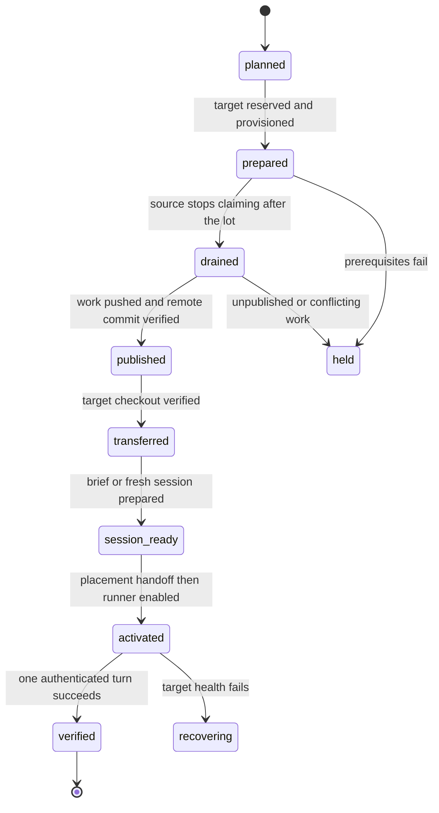

# Context

The assignment reports the owner's request of 12 October: ameesh should
prepare and perform the operational work itself. A human should approve an
OAuth grant or a reserved decision, rather than receive terminal commands.
This study treats that report as the scope of #255, not as a signed grant to
perform root operations, spend money or change production of a managed project today.
There is no infrastructure change in this study.

The baseline is `origin/main` at `b4ae4fd`, inspected on 12 October. The
private `.vm-plan` scripts are evidence, not reusable deployment policy:
no IP addresses, credentials or private configuration are copied here.
They may change after inspection. The implementation must regenerate plans
from current host cards, repository state and measured capacity.

# What the manual procedure teaches

| Source | Work a human had to prepare or trigger | Required replacement |
| --- | --- | --- |
| A | Stop workstation units, write a VM slice and drop-in as root, fetch two branches, make worktrees, check disk, start runners, then request fresh dsh sessions | Durable handoff, generated caps, measured disk admission, fresh session **before** starting a destination runner |
| B | Copy node/dsh and its agent profile, transfer an API key between VMs, install code, caps and PATH drop-ins, update a stale canon, select branches and commits, call `restart --brief`, resume agents and enable units | Inventory and versioned artifacts, store-to-host credentials, one deployment controller, verified repository identity and exact commits, ordered session preparation |
| C | Disable the source unit, sync canon, check target dirt, update code checkout, prepare a brief naming reassigned lots and the new assignment, resume and enable | Preserve assignment history in the brief; refuse a conflicting checkout; resume only an agent whose pause has been lifted |
| Main deployment plan | Choose the target commit, back up both databases, check/apply additive migrations, reapply SQL roles, edit account limits, restart outside turns, inspect health, arrange rollback | Release manifest, one migration authority per database, explicit configuration diff, health report, automatic bounded rollback |
| btrfs reclaim | Run a root script for two mountpoints, install tmpfiles configuration, optionally balance the root filesystem | Separate root decision with the exact mount UUIDs, script digest, expected impact and undo; reclaim is not an implicit part of placement |

The work root is not a reliable repository name: one `project-*` directory
contained an ameesh clone. Read `git remote get-url origin`, the common Git
directory, branch and HEAD on the source. Match the remote to the project's
allowed repository identities. A directory label is never evidence.

A stopped runner is not necessarily authorised to resume: B deliberately
keeps agents paused without `RESUME=1`. C changes the context of dev3 and
explicitly names former assignments. The controller must preserve pauses
and use the current assignment, rather than restarting the former lot.

# Options and recommendation

| Option | Benefit | Cost or missing guarantee |
| --- | --- | --- |
| Continue generating A/B/C scripts | Fast to prepare; easy to inspect | Ordering, recovery, capacity reservation and manual credential handling remain ad hoc |
| Adopt a new configuration-management stack now | Mature inventories and SSH execution | New deployment authority and secrets integration; does not by itself solve agent leases, lot boundaries or browser consent |
| Add a durable ameesh controller around the existing scripts | Reuses actual deployment practice and the mesh's assignments, leases and decisions | Requires a journal, narrow host helper and provider-specific login adapters |

Recommend the third option. Keep `poste.sh` and `vm.sh` as execution
primitives, factor shared steps, and make the controller responsible for
ordering, recovery and reporting. No new cloud VM, subscription or paid
service is needed for the pilot. A delegated helper replaces unrestricted
root SSH for routine operations after its installation has been approved.

# Placement and moving an agent

## Capacity and admission

Re-use host readings, the capacity guard, `max_agents`, admitted placements
and the strictest physical limits across canons. Measure every relevant
volume: system root, worktree, Git objects, private staging and database
storage. A stale reading, missing guard, blocked credential profile or
unreachable SSH endpoint makes a target unavailable. Proposed pilot values:
readings at most 60 seconds old; three consecutive pressure or spare-capacity
samples; a 30-minute cooldown per moved agent. These are design defaults to
validate, not an adopted host policy.

A full host offers outgoing moves. An under-used admitted host offers
incoming moves from a more constrained host, when there is queued work.
Do not move the agents off a healthy quiet host simply to make it busy.
Rank by capacity actually lent to ameesh, projected memory after reservation,
load and policy preference. Include clone/staging disk cost and simultaneous
heavy work; raw free memory alone is insufficient. Reserve the destination
slot transactionally before copying: two controllers must not both spend
the same headroom. Reservations expire and are rechecked at activation.

An already admitted target can be used within its policy. A new host or an
expanded placement needs a proposed Host/Placement PR and the canon's
approver. A PR proposal is not an admission. Sync and check the accepted
canon on both hosts before the handoff; pin its revision in the plan and
revalidate if it changes.

## A move is a recoverable operation between lots

The existing `relocation.py` changes registry placement between **turns**
and uses a short fallback summary when native sessions are local. It does
not synchronise a worktree, install tools or prepare credentials. L232 adds
a complete handoff and schedules it at a **lot boundary**. A pressure event
queues a move and holds the next lot; it does not interrupt a running lot.
If the current lot cannot finish safely on the source, hold its next turn,
report the reason and ask for an explicit checkpoint exception. The pilot
must also integrate this boundary with the existing automatic relocation
path, so it cannot bypass the preparation procedure.

The operation has an id, agent, source/target, lot checkpoint, source
lease epoch, canon revision, repository identity, branch and exact commit,
release revision, reservation, credential references and a recovery state:



1. Prepare target tooling, code, policy, credentials and capacity without
   enabling the agent's executor. Keep the source running its current lot.
2. At the lot boundary, mark the source draining and atomically prevent a
   new claim. Wait for no active turn, then stop/disable its unit. Checking
   `status != running` and later issuing `systemctl stop` is insufficient:
   there must be a fence against a claim in that interval.
3. Ask the source agent to publish its work before the boundary. Verify no
   tracked or untracked work would be lost, no private file would be added,
   no unpushed commits, and the exact commit reachable on the agreed remote
   branch. Never auto-commit all files or force-push. Dirt or a failed push
   holds the move; it does not delete the worktree.
4. Fetch the verified remote into an appropriate object store, create an
   agent-specific worktree and check branch and HEAD. Do not use `-B` on an
   existing conflicting branch. Do not overwrite dirty destination files.
   A detached checkout is valid only when recorded explicitly in the plan.
5. Prepare a new session: Claude/Codex `ameesh restart AGENT --brief -`;
   dsh `ameesh resume AGENT --fresh` once its pause may be lifted. The brief
   carries the previous lot's result, pushed commit, next assignment, host,
   work directory, thread/mail references and unresolved questions. Follow
   the VM memory procedure; do not copy native OAuth caches or assume native
   session files are portable. Copy dsh's secret-free agent profile/hooks as
   versioned configuration together with its pinned toolchain.
6. Commit the placement handoff with the source lease epoch, release the
   source lease and make it unclaimable there. Recheck destination policy,
   credentials and reservation; only then enable its executor. Session
   rotation/fresh resume must precede `enable --now`, the ordering lesson
   from B. Existing resume/registry semantics must be tested against the
   fence; a resume must not accidentally wake the source during this phase.
7. Verify an authenticated destination turn, correct checkout and caps,
   then close the operation and release the reservation. Retain the source
   worktree until verification and a separately recorded retention deadline.

Retries read the journal and verified effects rather than repeating every
command. A crash after enabling checks the current lease before retrying.
On failure, fence and drain the destination before restoring the source;
never create two executors for one agent. If the destination has published
new work, reconcile its exact commit before restoring. Expired source
workers cannot alter placement. Mail, current assignments and lot journals
stay in the mesh; a brief provides continuity, not authority.

# Deploying code and systemd through SSH

Use a separate controller service: restarting an executor from inside its
own cgroup can kill the deployment script. The controller survives its
caller's turn, records progress and sends a completion/failure report.

A release manifest binds a full Git commit, artifact digests, supported
schema versions, toolchain versions and host-specific configuration hashes.
Generalise these existing steps rather than add another installer:

1. `poste.sh verifier` / `vm.sh verifier`: check actual service mode, user,
   paths, SSH host identity, disk headroom, schema and active turns.
2. Correct `poste.sh sauvegarder` and its server backup helper before reuse.
   The workstation currently gives `pg_dump` the configured DSN in argv;
   a DSN containing a password exposes it to process inspection. The server
   helper also gives storage credentials to `curl --user`. Replace both
   with private credential channels: a password-free libpq service reference
   and a protected passfile for PostgreSQL; a protected curl configuration
   file or inherited private descriptor for storage authentication. No
   password-bearing DSN, credential argument or shell trace is permitted.
   Validate the entire process tree, including subprocesses and failures.
   Back up each affected database once and apply the backup rules below.
3. Correct the `poste.sh` dispatcher: it currently invokes `migrer` without
   forwarding REF, so checkout HEAD B migrates B even if release A was
   approved. Forward the explicit argument (for example, `migrer "${2:?REF
   required}"`), resolve the full approved commit once and use its snapshot
   for the dry-run and execution. Reject a missing or mismatched REF in the
   controller; no implicit HEAD is allowed. Enforce `--additive-only` on
   every autonomous dry-run/execution path independently of installed state:
   `migrer` currently drops this guard when its snapshot is already installed.
   A non-additive migration always needs its own approved plan and separate
   explicit path; `MIGRER_APRES` or an installed symlink cannot authorise it.
   Elect one migration worker per database identity and hold a database lock.
   Destination hosts use `vm.sh`'s migration-ready check; they do not migrate
   the shared database independently. Record the approved commit, snapshot
   identity, migration versions and guard mode in the operation journal.
4. Reapply executor/supervisor roles where needed and explicitly validate
   grants introduced by new tables. No ad hoc superuser DSN is given to a
   runner.
5. Stage the pinned snapshot and a separate venv, verify digests and imports,
   then switch the installed snapshot/venv together. Current scripts mutate
   a shared venv; extract a versioned-venv path to make rollback reliable.
6. Render slices and units from the effective Host policy for system or
   user mode. Install the aggregate slice, runner caps, node PATH, cargo
   settings and the VM guard service. The main deployment plan notes that
   the guard is not installed by `poste.sh` today: include it explicitly.
   Validate units before `daemon-reload`; record the prior configuration.
7. Drain and restart each affected executor outside turns under a claim
   fence, with a timeout that returns a recoverable operation, not a request
   for the owner to restart units by hand.
8. Check schema readiness, doctor, actual cgroup caps, guard state, CLI and
   one completed turn. Roll back code, venv and unit/configuration snapshot
   when checks fail; additive schema changes remain. Account-policy edits
   are a separate recorded diff, not a hidden effect of updating code.

## Backup completion, protection and recovery

The current server trigger ends in `|| true`, so a failed backup or upload
can be reported as success. Remove that suppression. A oneshot service's
inactive state is not proof of failure or success: inspect the completed
invocation's exit result, then verify its artifact. An absent optional storage
configuration must be reported as local-only; if remote storage is required
by the release policy, its absence or upload failure blocks migration.

Create credential/config files with mode `0600` in `0700` directories owned
by the authorised backup identity; unlink short-lived credential files on
success, failure and cancellation. Set `umask 077` before creating dumps,
restore logs or manifests. Backup directories are `0700`, local artifacts
`0600`, and access is limited to the backup/restore identities. Databases can
contain sensitive mail and state: dumps never enter a repository, ordinary
agent attachments or shared temporary storage. Remote artifacts use private
access controls and encryption, with the restore key held separately from
the write-only upload credential. Error reports contain categories and
artifact references only, not raw connection or storage configuration.

A successful backup means a non-empty finalized artifact for every required
database, an integrity digest, a readable archive catalogue and a successful
restore into an isolated disposable database. Verify expected schemas,
migration versions and representative row counts there; never restore over
a live mesh as a test. Verify the remote copy can be retrieved using the
separate restore identity and matches the local artifact before declaring
remote protection successful. A write-only upload identity cannot prove
restorability alone. Failed service result, archive inspection, retrieval or
restore holds the deployment before migration; retain the previous version.

The proposed pilot retention is 14 days for local and remote backups,
matching the server helper's current local window. The last verified
pre-release recovery set is pinned until the release is accepted and its
rollback window has ended, even if it crosses that age. Apply expiry to
both destinations and verification artifacts, preserve any explicit hold,
and journal deletion by artifact id. Space budgeting includes pinned backups;
insufficient space holds deployment rather than deleting its recovery set.
No automatic retention change is enacted by this study. The owner approves
the backup destinations/access/retention in the host operation policy.

SSH uses pinned known-host keys, `BatchMode=yes`, deadlines and no agent
forwarding. Initial host identity enrolment is an owner/admin decision;
never silently trust a newly seen key. A root-owned helper accepts typed
operations and approved manifest ids, not arbitrary shell text, paths or
service names. Use a forced command or a narrowly scoped sudo policy;
reject traversal, symlinks, unrelated units and unapproved payload digests.
Routine SSH authenticates a dedicated controller identity. Root is not
conferred on the agent executing a lot.

The existing `vm.sh` copies bundles to a fixed system temporary path and
assumes root SSH and one server layout. Replace that staging with a private,
quota-checked on-disk directory (`$TMPDIR` on the controller and an enrolled
host staging directory remotely). Never stage large objects on shared tmpfs;
remove temporary bundles after verified import. Retain bounded recovery
artifacts separately from temporary staging. Connection loss at each step
must leave the last successful deployment recoverable.

# API credentials from the mesh's store

`accounts.py` already selects host-local accounts and reads `key_file` or
a named environment variable. The inspected code has no general remote
secret-store delivery API. Do not describe host-to-host grep pipelines from
B as a central store. Inventory the actual mesh-owned store during L232c;
if it is a protected directory, use a narrow reader on the mesh host as the
pilot backend. A managed vault can implement the same interface later,
without becoming a prerequisite or introducing spend.

The canon and operation journal contain secret **references**, provider,
account, destination, revision and authorisation receipt only. Resolve an
allowlisted reference server-side; bind access to mesh, host and account.
Transfer over authenticated SSH directly to a destination install helper's
stdin. Secrets do not appear in arguments, stdout/stderr, shell traces,
mail, PRs, Git, controller JSON or general logs. Turn off command tracing;
errors are structured categories. Never print the source file to diagnose
it. No secret value, even a fingerprint derived from it, belongs in evidence.

The system store uses `0640 root:ameesh` beneath a protected directory.
Current `accounts.py` expects key files owned by the runner user with mode
`0600`; pointing it directly at that root-owned file would fail. Bridge with
systemd credentials or an atomic `0600` runner-owned account file in its
`0700` configuration directory, and validate with the account preflight.
A system credential design must test actual runner access before adoption.
A shared Unix user/group permits its members to read these credentials;
this pilot does not claim per-persona isolation. Admit only trusted hosts
and administrators; a host with root can read its agents' secrets.

Rotation stages a new version, checks format and permissions without
logging contents, switches atomically at a turn boundary and runs a bounded
credential health check. Keep the former version private until all intended
hosts confirm; revoke it centrally afterwards. Record versions and failure
categories. Missing, revoked or unhealthy credentials hold the affected
account rather than silently switch a subscription to paid API usage.
New secret enrolment or a broader destination needs a scoped owner decision;
a standing approved policy may cover subsequent routine delivery/rotation.

# OAuth: ameesh prepares, a human consents in a browser

Use one grant per host and account. Never copy Claude credentials, Codex
`auth.json`, or `gh`'s authentication cache from the workstation. Native
provider approval is separate from an ameesh owner decision: answering
`ameesh decide` cannot itself mint a provider grant.

| Adapter | What ameesh starts on the destination | What the human sees and does | Completion |
| --- | --- | --- | --- |
| Codex | `codex login --device-auth` in the isolated account home | Open the generated official link; sign in to the intended account; enter the displayed one-time code; confirm the host/account named in the request | The local process finishes and login status is checked without exposing its cache |
| Claude | Pinned CLI login flow (`/login`), or `claude setup-token` when that account policy needs a subscription token | Open the generated official URL; select the intended account/organisation; approve access; submit any returned authorization code through the private request page | Login state or captured token is installed privately, then the account preflight passes |
| GitHub | `gh auth login --hostname github.com --git-protocol https --web` | Open the generated device link; enter its one-time code; review the actual scopes and click the provider's Authorize button | Verify `gh auth status` privately and run `gh auth setup-git` as the runner user |

Codex's official headless flow requires device login enabled in account
security settings or workspace permissions. If disabled, ameesh prepares a
separate administrator request with the specific setting; it does not use
cache copying as a fallback in this design. See [OpenAI authentication](https://learn.chatgpt.com/docs/auth).

Claude `setup-token` prints its generated token, so its adapter must capture
and consume that output privately rather than relay the terminal stream.
`/login` uses subscription credentials; an existing API variable can select
a different account path. Scrub unrelated account variables and verify the
selected mode. See [Claude authentication](https://code.claude.com/docs/en/authentication).

GitHub CLI normally uses a credential store, but can fall back to a plaintext
file on a headless host. Preflight the intended storage and enforce a private
account directory and permissions; never send `gh auth token` output to the
report. See [GitHub CLI login](https://cli.github.com/manual/gh_auth_login).

The adapter is a supervised process with an expiry and a private output
channel. Only allowlisted URL/code fields reach an authenticated, expiring
approval view for the intended human; they are not broadcast in agent-mail
or placed in a public lot thread. Treat device and authorization codes as
sensitive. The ordinary `decide` question carries the host, provider,
account, scope, expiry and a link to that private view, not a raw token or
code. If the queue cannot carry a private view yet, L232d must add one before
using device approvals. Logs contain only state transitions.

Generate click instructions from the pinned adapter's actual challenge;
provider labels and CLI flags can change. Preflight the installed version
and refuse an unrecognised flow. Human instructions are concrete: open this
link, confirm this account and hostname, enter this code if requested, then
approve these scopes. No SSH, shell export, file copying or CLI launch is
left to the human. On expiry, cancellation or mismatch, terminate the
pending login, erase its private challenge, keep the agent auth-blocked and
prepare a new request when needed. Use bounded retries and avoid repeated
requests while the first remains pending.

# What stays with the owner

The owner chooses authority, spending and production changes, and performs
provider-native browser consent. Ameesh creates the complete script and
rollback evidence **before** asking. The following are concrete existing
execution primitives and required generated artifacts, not changes enacted
by this study:

| Reserved gesture | Prepared executable and evidence | Decision submitted by ameesh | Execution after approval |
| --- | --- | --- | --- |
| Initial root delegation, system user, SSH trust, network access | L232b generates a host-bound bootstrap script: exact user, root-owned helper, restricted controller key, directories and unit allowlist; digest, host key proof and undo script | Signed `decide ask` names that host and the bounded delegated operations | Existing authorised admin/controller runs the prepared script; absent root access is a reported prerequisite, never a request to invent credentials |
| Btrfs reclaim or other root storage tuning | Existing `.vm-plan/btrfs-reclaim.sh`, reviewed mount UUIDs, script digest, `--no-balance` choice; undo removes its tmpfiles entry and resets reclaim; cancellation command for the optional balance | Separate signed choice between no change, dynamic reclaim only, or reclaim plus bounded balance | Approved root executor runs the exact script; placement never starts balance implicitly |
| New spending, resize or paid API fallback | L232b prepares a provider-specific plan/apply/undo script only when requested; SKU, account, cost ceiling and scope must be known | Signed cost decision with a decline option; no purchase in this pilot | Controller applies once within the receipt's limit; unknown price or missing authority remains held |
| production of a managed project configuration or deployment | Existing release/deploy entry point for that project, pinned artifact, environment, diff, backup, smoke checks and rollback; identify the real entry point before asking | Separate signed production decision naming environment and artifact | Production executor runs the prepared plan; host provisioning credentials do not imply production authority |
| New secret access or expanding its destinations | L232c's install/rotate operation, references only, exact hosts/accounts, storage permissions and revocation plan | Scoped signed decision or verification of an existing signed delegation | Private store-to-host delivery; no secret is requested in mail |
| Provider login or enabling device login | L232d supervised remote adapter and private challenge page; for an admin setting, exact provider setting and account/workspace | `decide ask` directs the responsible human to the prepared browser view; policy changes require the proper administrator | Human clicks; adapter verifies completion and resumes the held provisioning step |

A request is never a prose mail asking someone to run a command. Example
for a prepared root artifact, with variables supplied by the controller:

```sh
ameesh decide ask --lot "$lot_id" \
  --question "Approve root bootstrap on $host_id: plan $plan_id, script $script_sha? Prepared diff and undo: $review_url" \
  --option a="Apply this prepared plan" --option b="Leave this host unchanged" \
  --recommend a --why "Required for the admitted host; no new spending" \
  --needs-signature --by 4h
```

The executor validates the signed receipt against the host, action, digest,
expiry and one-use operation. Changed scripts invalidate approval. A negative
answer holds only that operation; unrelated agents and already authorised
work continue. Routine deployments within an explicit standing delegation
need no repetitive owner prompt. Where no applicable delegation exists,
prepare the operation and ask through `decide`; do not infer authority from
the general wish for autonomy. Browser consent still requires its own human
interaction even when the operation has a signed policy approval.

# Delivery in four implementation lots

These are engineering estimates, excluding time waiting for owner/browser
consent, canon review or unavailable hosts. Suggested assignees remain for
mesh-design to choose. Total implementation: **18 hours** after this 4-hour
study. Dates below are Europe/Paris and depend on review of the study.

| Lot | Estimate | Planned start → delivery | Scope and acceptance |
| --- | --- | --- | --- |
| #363 / L232a — placement and durable handoff | 6 h | 2026-10-13 → 2026-10-13 | Full/under-used host planning, reservations, hysteresis, lot-boundary fence, remote/commit verification, brief/fresh session before enable, crash journal and single lease; no dirty or unpublished work lost |
| #364 / L232b — SSH release controller and delegated host helper | 7 h | 2026-10-13 → 2026-10-14 | Reuse poste/vm steps, pinned code/toolchain, root bootstrap script and decision, slices/drop-ins/guard, one migration per DB pinned to REF with unconditional additive-only, private backup credentials, verified restore/retention, independent controller, health and rollback, private on-disk staging |
| #365 / L232c — secret delivery and rotation | 2 h | 2026-10-14 → 2026-10-14 | Inventory the mesh store; private reference-based transfer, policy checks, root store to account-file/credential bridge, atomic rotation/revocation, no values in logs or Git |
| #366 / L232d — OAuth approval adapters and pilot | 3 h | 2026-10-14 → 2026-10-14 | Private browser challenge and decide queue, pinned Claude/Codex/gh adapters, expiry/cancel/retry, exact clicks, end-to-end pilot and evidence |

R1 review adds two hours to L232b (5 → 7 h) for the credential-channel,
backup restore and release-pinning corrections. The four-lot split and
13–14 October dates remain proposed; implementation lots stay unassigned
until r2 approval.

L232a can build with a fake prepared-host adapter while L232b is implemented.
Real activation depends on B and C readiness and D login where applicable.
C's estimate assumes a protected-file store is sufficient; a new vault or
new private-approval service beyond the existing approval stack requires
re-estimation before implementation. D is a deliberately small pilot of the
installed CLI versions, not a promise to support every provider release.

# Verification and rollout

Use fake SSH/systemd/store/login adapters for deterministic failures after
each journal step. Meaningful checks include two planners competing for one
slot, stale readings/canon/lease, source turn racing a drain, a dirty worktree,
unpushed commits, misleading directory names, missing dsh profile, paused
agent, OAuth expiry, SSH host-key mismatch, changed approved artifact and
migration concurrency. Deployment acceptance must also cover approved release
A with checkout HEAD B (only A's migrations run), a non-additive migration
with A already installed (still refused), and a failed server backup/upload
(no migration starts). Inspect process argv and synthetic credential canaries
for pg_dump, curl and their descendants; test unreadable/corrupt artifacts,
failed isolated restores, remote retrieval, permissions and pinned retention.
Inject a synthetic canary secret and assert it is
absent from stdout, stderr, mail, journals, Git diff and retained artifacts.

Run host integration on an already admitted test VM, with no new spend and
no production of a managed project change. First use dry-run, then one completed-lot dsh
move, then one Claude or Codex move with browser consent. Verify source unit
disabled, target session prepared before enable, one live lease, exact
checkout, real caps, healthy guard, private credential storage and a completed
turn. Exercise target failure and rollback without losing pushed work. Heavy
suites run through `ameesh heavy -- ...`.

Record the operation id, source/target, canon/release revision, exact commit,
checkpoint, phase timings, decision receipts and final health. Reports use
references and failure categories, never credentials. After a successful
pilot, expand only within admitted capacity and approved authority. An owner
should receive a ready decision or browser approval and the resulting report;
there should be no leftover instruction to restart, copy a token or fix a
checkout manually.
